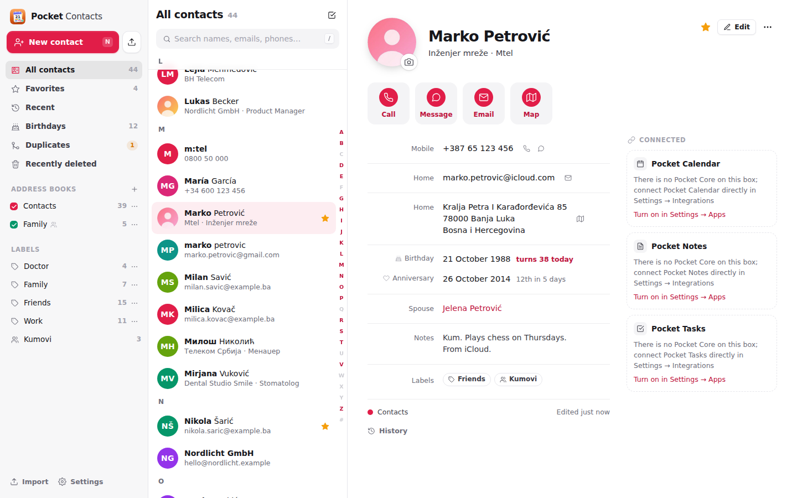
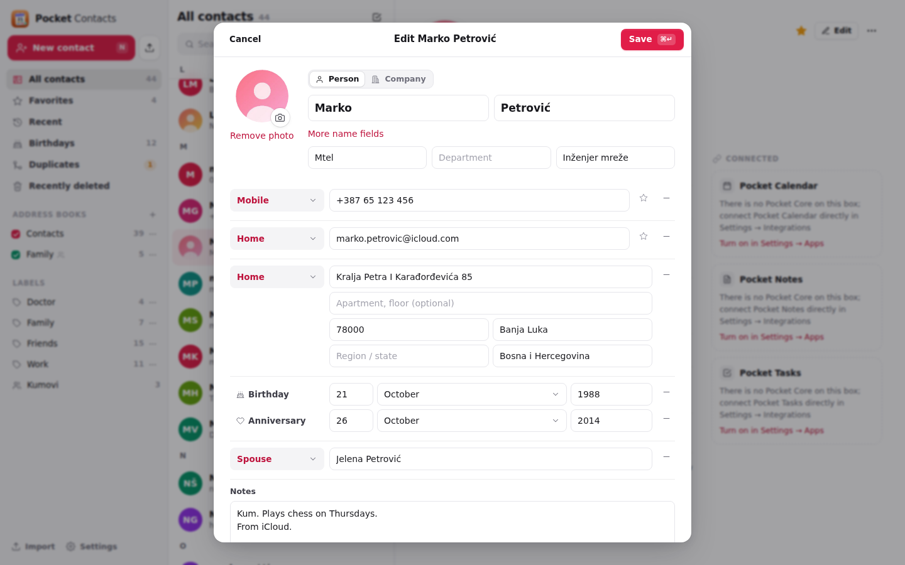
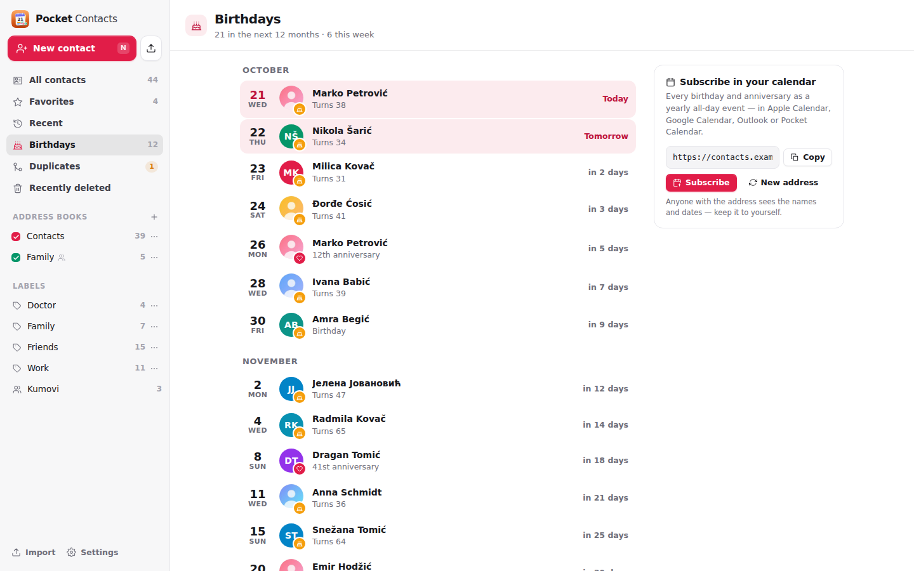
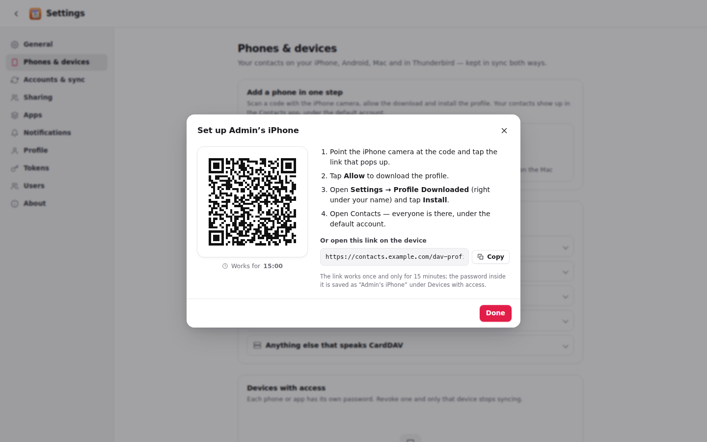
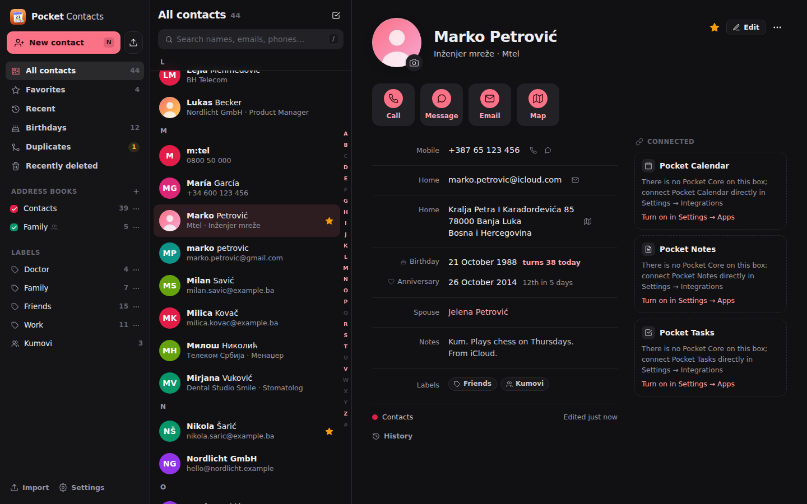
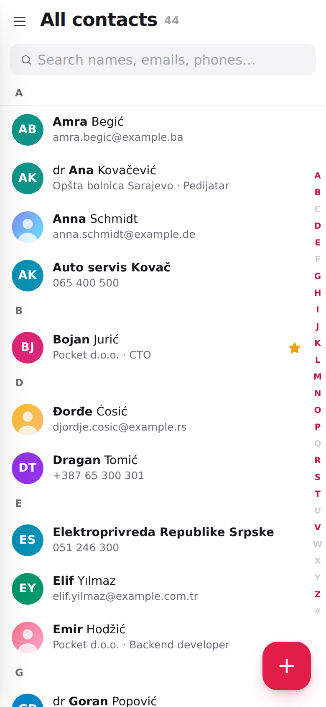
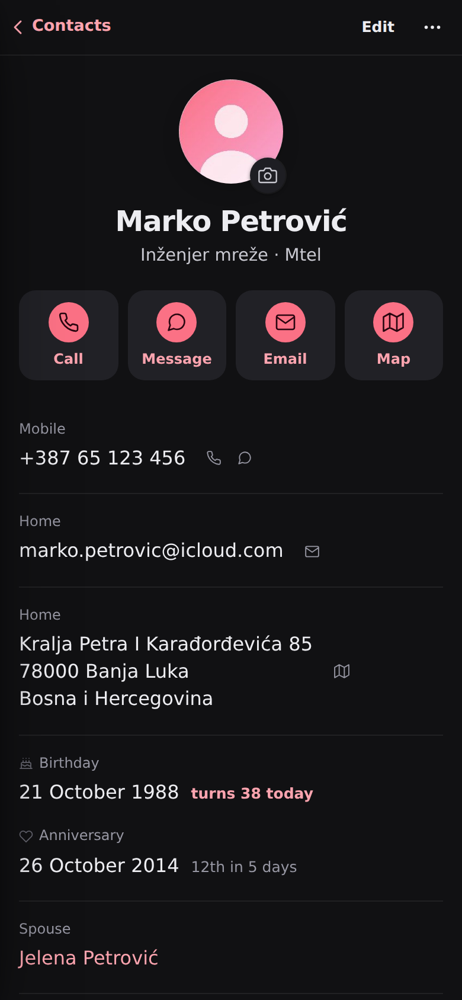

<p align="center"></p>
<h1 align="center">Pocket Contacts</h1>
<p align="center">Self-hosted contacts for a household: everyone you know in one searchable place, synced to every phone over CardDAV, imported from wherever they live today, and connected to the meetings, notes and to-dos you have with them.<br>One Go binary, one SQLite file, one volume.</p>

<p align="center"></p>

<table>
  <tr>
    <td width="50%"></td>
    <td width="50%"></td>
  </tr>
  <tr>
    <td align="center"><sub>Every vCard field, with labels from iPhone, Android and Nextcloud.</sub></td>
    <td align="center"><sub>Birthdays and anniversaries, reminded on the day.</sub></td>
  </tr>
  <tr>
    <td width="50%"></td>
    <td width="50%"></td>
  </tr>
  <tr>
    <td align="center"><sub>Scan a QR code with the iPhone camera: one profile, done.</sub></td>
    <td align="center"><sub>Dark mode.</sub></td>
  </tr>
</table>

<p align="center">
  &nbsp;&nbsp;
  
</p>

## What it does

**Contacts that stay yours**
- Every contact is a vCard kept exactly as the phone sent it; editing in the web app rewrites only the part you
  changed, so iPhone labels, Android extras and photos survive every round trip.
- Search as you type across names, nicknames, companies, emails, addresses and notes, folding diacritics and
  Cyrillic (`djordje` finds *Đorđe*, `jelena` finds *Јелена*) and matching any digits of a phone number however it
  was written.
- Favorites, recent, labels (the groups Nextcloud, Android and Google use) and Apple contact groups, multi-select
  for bulk changes, Recently deleted for 30 days, a change history per contact, ⌘K and keyboard shortcuts.

**On every device**
- A CardDAV server for iPhone, iPad, Mac, Android (DAVx5) and Thunderbird. On an iPhone, scan a QR code in
  Settings → Phones and install the profile; the account is set up so it appears under *Default Account*.
- Address books shared with the people on the box (read, write or manage), or with everyone.

**Bring everything in**
- Import `.vcf` (including old vCard 2.1 phone exports in Windows-1250), Google and Outlook CSV, any CSV with a
  header row, or a `.zip` of them — with a preview first and duplicates merged instead of doubled.
- Connect Nextcloud (through Pocket Core, with your own login), iCloud or any CardDAV server: import once, or keep
  both sides in sync.
- Duplicates found by name, email and phone, merged field by field, never on their own.

**Connected to the other Pocket apps** (through Pocket Core app links, as you)
- **Pocket Calendar**: the meetings you had and have with someone on their page, *New event* with them invited;
  the calendar shows birthdays and suggests guests from your contacts.
- **Pocket Notes**: the notes that mention someone, *New note* about them; in Notes, *Link to something* inserts a
  link to the person.
- **Pocket Tasks**: the to-dos about someone, *Remind me* to call them back.
- Birthday reminders through Apprise, ntfy or a webhook, and a subscribable birthday calendar.

## Run it

```sh
docker run -d --name pocket-contacts -p 8080:8080 -v ./data:/data \
  -e BASE_URL=https://contacts.example.com -e SECURE_COOKIES=true \
  ghcr.io/abjelosevic88/pocket-homelab-contacts:latest
```

Open it, create the first account, then add your phone from Settings → Phones & devices. See
[docs/configuration.md](docs/configuration.md) for every option, [docs/carddav.md](docs/carddav.md) for phones and
other CardDAV clients, [docs/api.md](docs/api.md) for the API and [docs/design.md](docs/design.md) for how it works.

Try it with made-up people: `make web build && DATA_DIR=/tmp/pc DEMO_DATA=true AUTH_MODE=none ./pocket-contacts`.

## Built with

Go, chi, SQLite (modernc, FTS5), React 19, Vite. Part of the Pocket apps; works alone, and with
[Pocket Core](https://github.com/abjelosevic88/pocket-homelab-core) for single sign-on, paired phones and the links
between apps. MIT licensed.
